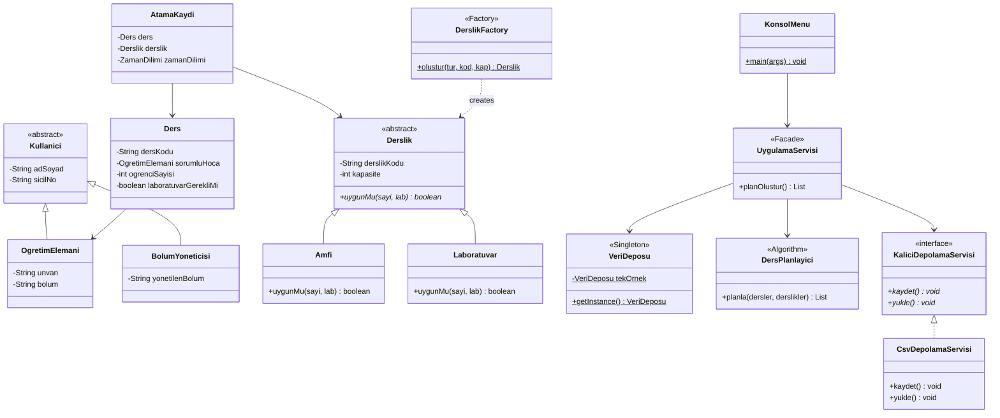

# Akıllı Kampüs Ders Programı Sistemi

Bu proje, **Nesneye Yönelik Programlama (NYP)** dersi dönem ödevi kapsamında geliştirilmiştir. Projenin amacı; üniversite bünyesindeki öğretim elemanları, derslikler ve dersler arasındaki kaynak çakışmalarını engelleyerek çakışmasız, kurallara uygun bir haftalık ders programı oluşturmaktır.

Proje Java dili ile geliştirilmiş olup konsol tabanlı bir menü üzerinden çalışmaktadır. Veriler disk üzerinde CSV dosyalarında kalıcı olarak saklanmaktadır.

---

## Sistem Özellikleri ve Kurallar

1. **Öğretim Elemanı Çakışma Önleme:** Bir öğretim elemanına aynı gün ve saat diliminde birden fazla ders atanamaz.
2. **Derslik Çakışma Önleme:** Bir dersliğe aynı gün ve saat diliminde birden fazla ders atanamaz.
3. **Kapasite Kontrolü:** Dersin öğrenci sayısı dersliğin kapasitesinden fazla ise o dersliğe atama yapılmaz.
4. **Laboratuvar / Amfi Uygunluğu:** Laboratuvar gerektiren dersler yalnızca laboratuvarlara, teorik dersler ise amfilere atanır.
5. **Kalıcı Depolama:** Eklenen tüm hocalar, derslikler ve dersler `veri/` klasörü altındaki CSV dosyalarına kaydedilir ve program açılışında otomatik yüklenir.

---

## Mimari Yapı ve NYP Prensipleri

Projemizde nesneye yönelik programlamanın 4 temel ilkesi uygulanmıştır:

- **Kalıtım (Inheritance):**
  - `Kullanici` soyut üst sınıfından `OgretimElemani` ve `BolumYoneticisi` sınıfları türetilmiştir.
  - `Derslik` soyut üst sınıfından `Amfi` ve `Laboratuvar` sınıfları türetilmiştir.
- **Soyutlama (Abstraction):**
  - `Derslik` sınıfı `abstract` olarak tanımlanmış olup gövdesiz `uygunMu(...)` soyut metodunu barındırır.
  - `KaliciDepolamaServisi` arayüzü ile dosya saklama mantığı soyutlanmıştır.
- **Çok Biçimlilik (Polymorphism):**
  - `uygunMu(...)` metodu `Amfi` ve `Laboratuvar` sınıflarında farklı şekilde ezilmiştir (`@Override`).
  - Algoritma, sınıfın somut tipini bilmeden `derslik.uygunMu(...)` çağrısı yapar ve çalışma zamanında ilgili sınıfın kuralı işletilir.
- **Kapsülleme (Encapsulation):**
  - Alanlar `private` yapılmış, dış dünyadan korunmuş ve kontrollü getter/setter metodları üzerinden erişim sağlanmıştır.

---

## Kullanılan Tasarım Kalıpları (Design Patterns)

Projede aşağıdaki tasarım kalıpları uygulanmıştır:

1. **Factory Method (Fabrika Metodu) - `patterns.DerslikFactory`:**
   - İstemci kodlarının `new Amfi(...)` veya `new Laboratuvar(...)` gibi somut sınıflara bağımlı kalmadan tek bir merkezden derslik nesnesi üretmesini sağlar.
2. **Singleton (Tek Nesne) - `patterns.VeriDeposu`:**
   - Sistem genelindeki ders, derslik ve öğretim elemanı listelerinin bellekte tek bir kopya üzerinden tutarlı şekilde yönetilmesini garanti eder.
3. **Façade (Ön Yüz) - `services.UygulamaServisi`:**
   - Konsol menüsü ile alt sistemler (`VeriDeposu`, `DersPlanlayici`, `CsvDepolamaServisi`) arasındaki karmaşık bağlantıları sade bir arayüz arkasında toplar.

---

## SOLID Prensipleri Uygunluğu

- **Single Responsibility Principle (SRP):** Her sınıf tek bir sorumluluğa sahiptir. Örneğin `DersPlanlayici` sadece atama algoritmasını yönetir, `CsvDepolamaServisi` sadece dosya okuma/yazma yapar.
- **Open/Closed Principle (OCP):** Yeni bir derslik türü (ör. `SeminerSalonu`) eklenmek istendiğinde mevcut sınıflar değiştirilmeden `Derslik` sınıfından türetilir ve `DerslikFactory`'ye eklenir.
- **Liskov Substitution Principle (LSP):** `Derslik` tipindeki referanslar yerine `Amfi` veya `Laboratuvar` nesneleri sorunsuz şekilde kullanılabilir.
- **Interface Segregation Principle (ISP):** `KaliciDepolamaServisi` arayüzü yalnızca `kaydet()` ve `yukle()` metodlarını içerir, gereksiz metot dayatmaz.
- **Dependency Inversion Principle (DIP):** `UygulamaServisi`, somut dosya sınıfına değil `KaliciDepolamaServisi` arayüzüne bağımlıdır (Constructor Injection).

---

## UML Sınıf Diyagramı

Projenin sınıf diyagramı ve detaylı mimari açıklamaları projedeki şu dosyalarda yer almaktadır:
- `UML_SINIF_DIYAGRAMI.md` (Mermaid ve açıklayıcı metinler)
- `uml_sinif_diyagrami.svg` (Vektörel sınıf şeması)
- `uml_diyagrami.puml` (PlantUML dosyası)



---

## Birim Testleri (JUnit 5)

Hazırlanan 12 birim testi `src/test/java/AkilliKampusTest.java` dosyasındadır. Testler aşağıdaki komutla çalıştırılabilir:

```bash
mvn test
```

### Test Edilen Durumlar:
1. `test1_AmfiUygunlukKurali`: Amfi polimorfik uygunluk kontrolü (kapasite ve lab gereksinimi).
2. `test2_LaboratuvarUygunlukKurali`: Laboratuvar polimorfik uygunluk kontrolü.
3. `test3_DerslikFactoryUretimi`: Factory kalıbı ile doğru sınıfın üretilmesi ve geçersiz tür kontrolü.
4. `test4_VeriDeposuSingletonTekilligi`: Singleton deseninin tekil nesne üretme ve veri tutarlılığı kontrolü.
5. `test5_DersPlanlayiciBasariliAtama`: Algoritmanın temel ders atama testi.
6. `test6_DersPlanlayiciHocaCakismasiOnleme`: Aynı hocanın iki dersinin farklı saatlere yerleştirilmesi.
7. `test7_DersPlanlayiciDerslikCakismasiOnleme`: Aynı sınıfa atanan iki dersin farklı saatlere yerleştirilmesi.
8. `test8_DersPlanlayiciKapasiteYetersizLigindeAtamaYapilmaz`: Kapasite yetersizliğinde atama yapılmaması.
9. `test9_DersPlanlayiciLabGereksinimiEslestirme`: Lab gerektiren dersin sadece laboratuvara atanması.
10. `test10_CsvDepolamaKaydetVeYukle`: Verilerin CSV dosyasına yazılıp diskten eksiksiz okunması.
11. `test11_UygulamaServisiFacadeEntegrasyonu`: Servis katmanı üzerinden uçtan uca akış kontrolü.
12. `test12_KalitimVeKapsulleme`: Kalıtım ve kapsülleme (getter/setter) kontrolleri.

---

## Kurulum ve Çalıştırma

### Gereksinimler:
- Java JDK 17 veya üzeri
- Maven (veya IntelliJ IDEA dahili Maven)

### Projeyi Derleme:
```bash
mvn clean compile
```

### Testleri Çalıştırma:
```bash
mvn test
```

### Uygulamayı Çalıştırma:
IntelliJ IDEA üzerinden `Main.java` ya da `ui.KonsolMenu.java` çalıştırılabilir. Terminalden çalıştırmak için:
```bash
java -cp target/classes ui.KonsolMenu
```
veya Maven ile:
```bash
mvn exec:java -Dexec.mainClass="ui.KonsolMenu"
```
