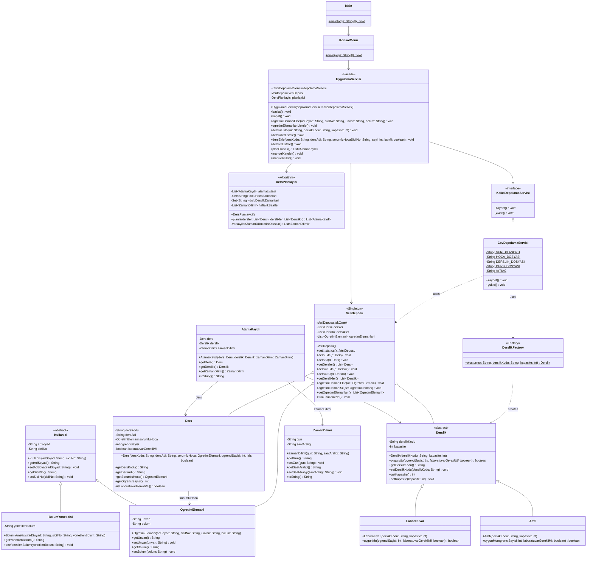

# Akıllı Kampüs Ders Programı Sistemi - UML Sınıf Diyagramı

Bu doküman, projenin mimari yapısını, sınıflar arası ilişkileri, uygulanan nesneye yönelik programlama ilkelerini ve tasarım kalıplarını açıklamak üzere hazırlanmıştır.

---

## 1. UML Sınıf Diyagramı (Mermaid)

---

## 2. Tasarım ve Mimari Kararları

- **Kalıtım ve Polimorfizm:** `Derslik` sınıfı soyut bırakılarak `Amfi` ve `Laboratuvar` alt sınıflarına uygunluk mantığı devredilmiştir. Algoritma somut tipleri sorgulamadan `derslik.uygunMu(...)` üzerinden polimorfik olarak çalışır.
- **Factory Pattern:** Derslik nesnelerinin üretimi `DerslikFactory` sınıfına verilerek istemci sınıfların doğrudan `new` anahtar kelimesi ile sınıflara bağlanması engellenmiştir.
- **Singleton Pattern:** Uygulama çalışma zamanındaki verilerin tek bir merkezden (`VeriDeposu`) yönetilmesi sağlanmıştır.
- **Façade Pattern:** Konsol menüsünün alt sistemleri ayrı ayrı yönetmek yerine sadece `UygulamaServisi` ile haberleşmesi sağlanarak gevşek bağlılık (loose coupling) elde edilmiştir.
- **File I/O:** `KaliciDepolamaServisi` arayüzü ile dosya saklama soyutlanmış, `CsvDepolamaServisi` ile CSV formatında kalıcı depolama sağlanmıştır.
